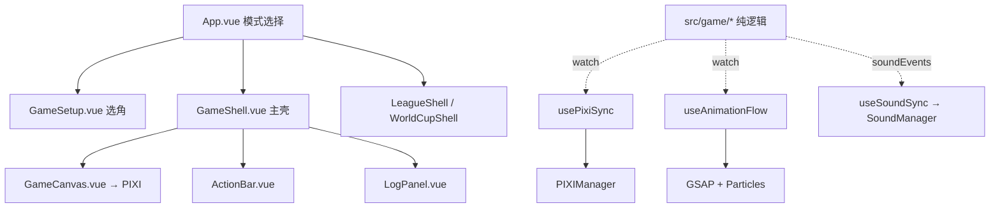

# CLAUDE.md

亡命十三街 — 基于扑克牌的多人对战游戏。Vue 3 驱动 UI，PixiJS v8 渲染牌桌，GSAP 负责动画，Tauri 打包桌面端。
本项目使用中文与用户交流。

**当前形态：Vue 3 + PixiJS + Tauri 版（Godot 4.7 迁移已终止，`godot/` 已移除，git 历史可找回）。**

**线上地址：** `https://dead13game.github.io/dead13`（GitHub Pages 自动部署）

## 常用命令

```bash
npm run dev          # Vite 开发服务器
npm run build        # 生产构建（vite build → postbuild 内联）
npm run preview      # 预览构建产物
npm run test         # 运行 vitest 测试
npm run tauri:dev    # Tauri 桌面开发
```

## 禁用操作

PR以及gh CLI会导致用户GitHub账户封禁，禁止使用。
禁用worktree分支，修改直接作用在main里
禁止自己git push操作，更新完游戏提醒用户手动push
禁止批量拉代码（git clone / git pull），如确实需要先向用户确认

> 以上 git push / gh CLI / git clone / git pull 已写入 `reasonix.toml` 的 `[permissions] deny`，任何模式（含 yolo）都会硬阻断。
> **允许本地 commit**（`git commit` 可执行），仅 push 禁止——任务完成、测试通过后可自行提交。

## 核心设计原则（最重要，每次变更必须遵守）

1. **`src/game/` 分层且零依赖。** `core/ rules/ characters/ flow/ modes/ persistence/` 不引用 Vue、PIXI、GSAP 或浏览器 API(控制器传进来的 `reactive` 除外)。规则全在 `rules/`,角色全在 `characters/`,状态写入全在 `flow/`。
2. **单向数据流：** `state`(Vue reactive)→ `buildView(state)` 只读视图 → `usePixiSync` / 组件 → 渲染。**UI 不直接写 state**,所有动作走 `dispatch(state, command)`。
3. **新机制用 `pending` 决策对象,不用 step 字符串 + flag。** `state.step` 是 `pending` 的派生量(仅为兼容 UI 模板保留),`setPending` 是唯一写入口。
4. **PixiJS 对象用 `shallowRef`，不用 `ref()`。** Vue 深度响应式代理会破坏纹理引用。GSAP 动画用 `sprite.scale.x` 不是 `scaleX`。
5. **伤害计算：先 -2 再 2:1 联盟分配，向下取整（`Math.floor`）。** 加成顺序写在 `rules/modifiers.js` 的 priority 常量里,顺序即规则。
6. **角色数据用 `getCharData(player)` / `CHARACTERS` 查表。** 角色专属状态放 `player.char`(由插件 `stateSchema` 声明),通用状态放 `resources/effects/relations`。
7. **Player 字段分区写完整路径。** 资源 → `player.resources.xxx`,效果 → `player.effects.xxx`,关系 → `player.relations.xxx`,圣遗物 → `player.artifact.xxx`。
8. **行动顺序按 `CHARACTERS[id].speed` 在开局排序一次。** speed 降序（大=先动）,同速按创建顺序;`player.uid` 是稳定身份,`index` 只是渲染序。

## 行为准则 — 信息不足时必须追问（最重要）

**绝对禁止在信息不完整时猜测或假设。** 以下情况必须停下来追问用户，不继续执行：

1. **Bug 报告太模糊** — 用户只说「XX 有 bug」但没有给错误日志、复现步骤、预期/实际行为。追问：「请提供控制台报错或 `[game]` 日志，并描述预期行为 vs 实际行为」
2. **功能需求不明确** — 用户说「加一个新角色」但没给技能名称、效果、数值。追问：「新角色的技能是什么？效果数值？是否有使用次数限制？」
3. **多个可能原因时** — bug 有 2 个以上可能的原因时，不要赌一个去改。列出所有假设，追问用户或读日志排除后再改。
4. **第一次听说的问题** — 用户描述的问题不在已修复 Bug 列表或你的认知范围内，先追问细节，不要直接动手。

**好的提问示范：**

> 「你说的『攻击伤害不对』，具体是哪个角色攻击哪个目标？伤害值预期多少、实际多少？控制台 `[game]` 日志里 `damage_calc` 那行输出是什么？」

**善用question** — 不确定的地方不要猜测，question用户获得最准确的方向,不用担心question太多,有疑问无上限问

## 架构



| 层       | 目录                 | 职责                                                                                                                                                                              |
| -------- | -------------------- | --------------------------------------------------------------------------------------------------------------------------------------------------------------------------------- |
| 纯逻辑   | `src/game/`        | `core`(牌/随机/玩家/单位)+`rules`(加成/伤害/陷阱/联盟/天气)+`characters`(15 角色插件)+`flow`(ctx/pending/turn/commands)+`modes`(经典/1v1/联赛/世界杯/团战)+`persistence`;零依赖 |
| 桥接     | `src/bridge/`      | 监听只读 view → 驱动 PIXI + GSAP + 音效                                                                                                                                          |
| 渲染     | `src/pixi/`        | PixiJS v8 Application + 精灵 + 布局 + 粒子                                                                                                                                        |
| 控制器   | `src/composables/` | useGameController / useLeagueController / useWorldCupController / useBrawlController(建房、存档、模式编排)                                                                                             |
| 爬塔     | `src/solo/`        | 单机模式（logic/ 纯逻辑 + useSoloController + SoloShell）                                                                                                                         |
| 模拟宇宙 | `src/simuniverse/` | PVE 无尽深渊（logic/ 纯逻辑 + useUniController + UniShell，DOM 渲染，不依赖 PIXI）                                                                                                |
| 音频     | `src/audio/`       | SoundManager 音效播放（由`src/game/soundEvents.js` 触发）                                                                                                                       |
| UI       | `src/components/`  | Vue 3 组件（ActionBar、League*/WorldCup* 系列等）                                                                                                                                 |

**参考文档(改 `src/game/` 前先读)**

| 文档 | 内容 |
| --- | --- |
| [docs/classic-refactor-plan.md](docs/classic-refactor-plan.md) | 内核架构速查:分层、状态模型、加成顺序、加角色/改规则的步骤、常见坑、验证方式 |
| [docs/KNOWN_BUGS.md](docs/KNOWN_BUGS.md) | 已知 bug 与修复记录(含回归测试索引) |
| [docs/simuniverse-design.md](docs/simuniverse-design.md) / [docs/solo-roguelike-design.md](docs/solo-roguelike-design.md) | 模拟宇宙 / 单机模式设计 |

## 游戏模式

| 模式     | 入口                               | 逻辑文件                                             | 说明                                                                                                                                                                                                  |
| -------- | ---------------------------------- | ---------------------------------------------------- | ----------------------------------------------------------------------------------------------------------------------------------------------------------------------------------------------------- |
| 经典对战 | `App.vue` gameMode               | `src/game/flow/commands.js` + `modes/classic.js` | 2-8 人扑克对战，选角色 + 天气                                                                                                                                                                         |
| 世界杯   | `App.vue` wcStarted              | `src/game/worldCup.js` + `modes/match.js`        | 小组赛 A-H → 淘汰赛 R16/QF/SF/Final；常规 90 回合 + 加时 30；点球先得 5 分、每方抽 2 张                                                                                                              |
| 联赛     | `App.vue` leagueStarted          | `src/game/league.js` + `modes/league.js`         | 10 支英超球队，tier 1-3（🏆争冠/⚔️欧战/🛡️保级）；每场 4 回合和平期；3V3 围攻/补给/名次积分；队标`public/team-badges/{teamId}.png`                                                               |
| 3v3 团战 | `App.vue` gameMode='brawl'       | `src/game/modes/brawl.js` + `useBrawlController.js` | 双方各 3 英雄 + 5 塔（10 HP）；前 4 回合和平期；Ban/Pick 15 角色；5 回合复活；60 回合按拆塔/存活/总血量判定；AI/同屏双人；DOM 渲染；存档走 `dead13_save` |
| 单机     | `App.vue` gameMode='solo'        | `src/solo/logic/solo.js`                           | 技能卡肉鸽：章节爬塔/抽3选2/事件检定/商店营地（DOM 渲染）                                                                                                                                             |
| 模拟宇宙 | `App.vue` gameMode='simuniverse' | `src/simuniverse/logic/uniState.js`                | PVE 无尽深渊：位面 1-10/11-30/31-60/61+ 循环；扑克牌普攻/防御/开大三选一；敌人模板行动；祝福/奇物/方程；商店/休整/造物调试台；存档 `dead13_uni_save`；设计文档 `docs/simuniverse-design.md`       |
| 娱乐模式 | `App.vue` gameMode='dicewar'     | `src/game/diceWar.js` + `diceWarCommentator.js`  | 骰子战争世锦赛：16 人（原神8+崩铁8）随机配对淘汰；每局 30 轮先/后手各掷 2~12，每 10 轮段间对比，平局加赛；决赛七局四胜；每 10 轮 AI 解说（密钥存 `dead13_ai_settings`，浏览器直连 LLM，无本地兜底） |

1v1 比赛由 `modes/match.js` 在经典内核之上叠加:进球、每命重置、换人、加时、点球。
模式差异全部写在各自 adapter 的 `rules` 字段里(`peaceRounds / attackGate / alliance / besiege` 等),不再靠 context 是否存在隐式切换。

## 游戏状态机

```
PHASE: SETUP → PEACE(前N回合禁攻) → NORMAL(战斗) → GAME_OVER
PENDING:  action | target(purpose) | gambleSetup | scryOrder | liniya | saveOrLoad
STEP:     由 pending 派生 = pickAction / attackShowCard / skillPickTarget / gamblePick /
          skillNahida / liniyaPick / caiyueangPick / allyPick
```

- **唯一的「等待玩家作答」载体是 `state.pending`**;`state.step` 只是它的派生字符串,供 ActionBar 的 `v-if` 与动画桥接使用。
- `pending.asker` 是 uid,`pending.options` 是可选目标 uid 列表,`pending.purpose` 是语义标签(`attack` / `ally` / `skill:aimiliya.freeze` …),UI/AI 都读它,不再判 `_fenjinHeal` 之类私有 flag。
- 取消待决 = `dispatch({ type: "cancel" })`。

## 调试工具

| 工具                    | 用途                                                                                                                        |
| ----------------------- | --------------------------------------------------------------------------------------------------------------------------- |
| `npm run test`        | 444 条 vitest 测试（24 文件：core/flow/rules/modes/persistence/api + 差分回放 + TableLayout + 角色/团战 v3.5 + solo/uni×3 + diceWar），< 2s |
| 手动跑 test             | 改`src/game/*` 后必须跑 `npm run test`（项目无自动 hook，靠自觉）                                                       |
| `window.__PIXI_APP__` | 浏览器控制台访问 PIXI Application 内部状态                                                                                  |
| `[game]` 日志         | `console.debug` 输出结构化 JSON，`window.__GAME_LOG_LEVEL__` 动态控制等级                                               |

## 内核入口与命令(取代旧的 gameState.js 导出)

| 入口                                                                                                          | 说明                                     |
| ------------------------------------------------------------------------------------------------------------- | ---------------------------------------- |
| `createSession({ state, chars, weather, startRound, teamIds, mode })`                                       | 建房:initGame + ctx + turn engine + mode |
| `dispatch(state, command)`                                                                                  | **唯一写入口**                     |
| `buildView(state)`                                                                                          | 只读 view-model(UI/PIXI/AI 都读它)       |
| `save(state)` / `load(state, data, { modeFactory })`                                                      | 存档 v4                                  |
| `createClassicMode()` / `createMatchMode()` / `createLeagueMatchMode()` / `createWorldCupMatchMode()` | 模式适配器                               |

命令一览(`dispatch` 的 `type`):

| type | 参数 | 说明 |
| ----------------------------- | --------------------------------------------------------------------------- | -------------------------- |
| `attack` / `attackTarget` | `targetUid` | 摸牌进入待决 → 选目标结算 |
| `defense` / `defenseTarget` | `targetUid`（团战支援） | 抽防御牌；团战可选自己/队友/己方塔 |
| `gamble` / `gambleSubmit` / `gambleTarget` | `trapIdx, baitIdx` / `targetUid` | 赌命；团战可把陷阱布置给队友/塔 |
| `skill` / `skillAnswer` | `answer`(目标 uid 或 `{targetUid, subSkill}` / 排序数组 / `{choice}`) | 技能与作答 |
| `ally` / `allyTarget` | `targetUid` | 结盟 |
| `betray` | — | 背刺 |
| `holyWord` | — | 圣言自明 |
| `cancel` | — | 取消待决 |

## PIXI ↔ Vue 桥接

| 接口 | 方向 |
| ------------------------------------------------------ | ------------ |
| `usePixiSync(view, getManager)` | view → PIXI |
| `useAnimationFlow(view, getManager)` | view → PIXI |
| `PIXIManager.buildScene(players, deckCount)` | PIXI |
| `PIXIManager.updatePlayer(index, player, isCurrent)` | PIXI |
| `GameShell.onRelayout()` | Vue → PIXI |

`view` 由 `buildView(state)` 产出:它是**只读派生**,不是第二份状态;写操作一律 `dispatch`。

## player 对象渲染字段(经 view 映射)

`view.js` 的 `renderPlayer()` 把内核字段映射成 UI 读的形状,`PlayerTableSprite._updateStatus()` 依赖:
`statusEffects.frozenBy`, `relations.allyIndex`, `relations.allianceTurns`, `relations.betrayalPenalty`,
`statusEffects.stealTarget`, `statusEffects.dotTarget`, `fightingSpirit`, `statusEffects.savepoint`,
`statusEffects.extraAction`, `statusEffects.ignoreTrapThisTurn`, `relations.gamblePenalty`, `relations.consecutiveGambles`

→ 新增状态标签时:先在内核加字段(`effects.xxx` / `char.xxx`),再在 `view.js` 映射,最后改 `_updateStatus()`。

v3.5 新增映射：`chorus`（沃雅妮莎领唱）、`attackStreak`（薇斯纳连击）、`statusEffects.drone`（无人机 HP/盾），以及 `towers` / `summons` / `units` / `unitByUid`（团战塔与召唤物，不影响经典 `players`）。

## 构建关键点

- **`codeSplitting: false`**（vite.config.js）— PixiJS v8 动态 import 在 file:// 协议会失败，必须合并单一 bundle。
- **`resolution` 上限 2x** — `Math.min(dpr, 2)`，移动端 3x 屏 GPU 过载。
- **分发用线上 URL** — 不要依赖 file://（iOS WKWebView 彻底禁止）。
- **Canvas**: 默认 `position: fixed; z-index: 1`；竖屏滚动切为 `position: relative; touch-action: pan-y`。

## 关键文件

| 文件                                     | 说明                                                           |
| ---------------------------------------- | -------------------------------------------------------------- |
| `src/game/index.js`                    | 门面:只导出 api / view / characters / modes                    |
| `src/game/api.js`                      | `createSession` / `dispatch` / `save` / `load`         |
| `src/game/view.js`                     | 只读 view-model(`renderPlayer` 映射 + 选择器)                |
| `src/game/core/cards.js`               | 牌/洗牌/抽牌(随机源显式传入)                                   |
| `src/game/core/rng.js`                 | 唯一随机入口(种子版用于回放)                                   |
| `src/game/core/player.js`              | Player 工厂 + 字段分区默认值                                   |
| `src/game/core/units.js`               | 英雄/塔/无人机统一查询、可攻击目标、拆塔顺序                   |
| `src/game/rules/modifiers.js`          | 有序加成管道(priority 即规则)                                  |
| `src/game/rules/damage.js`             | 伤害结算唯一入口(返回报告)                                     |
| `src/game/rules/trap.js`               | 陷阱三态(反弹/平局/击破)                                       |
| `src/game/rules/alliance.js`           | 结盟/平摊/解散                                                 |
| `src/game/rules/artifacts.js`          | 圣遗物 + 圣言自明                                              |
| `src/game/characters/*.js`             | 15 个角色插件(meta/stateSchema/canUse/use/onAnswer/hooks)      |
| `src/game/flow/context.js`             | 显式 ctx(日志/音效/牌堆/玩家/turn 接线)                        |
| `src/game/flow/pending.js`             | 决策模型 + step 派生                                           |
| `src/game/flow/turn.js`                | 回合引擎(pass/extra/suspend/resync)                            |
| `src/game/flow/commands.js`            | 全部命令(攻击/防御/赌命/技能/结盟/圣言/取消)                   |
| `src/game/flow/setup.js`               | 局面创建与初始化                                               |
| `src/game/modes/*.js`                  | classic / match / league / worldcup / brawl 适配器             |
| `src/game/modes/brawl.js`              | 3v3 团战：塔行动/复活/劣势补给/60 回合判定                     |
| `src/composables/useBrawlController.js` | 团战 Ban/Pick、开局、存档、简单随机 AI 调度                    |
| `src/components/BrawlShell.vue`        | 团战 DOM 棋盘 UI（英雄卡/塔卡/BanPick/结算）                  |
| `src/game/persistence/*.js`            | 存档 schema / 读写 / 菜月昴快照                                |
| `src/game/league.js`                   | 联赛数据(球队/赛程/积分/加成)                                  |
| `src/game/worldCup.js`                 | 世界杯赛程编排                                                 |
| `src/game/ai/index.js`                 | AI 公共 API(读 view)                                           |
| `src/game/ai/skilled.js`               | AI 熟练难度                                                    |
| `src/game/ai/hell.js`                  | AI 地狱难度(偷看牌库)                                          |
| `src/game/ai/easy.js`                  | AI 简单难度                                                    |
| `src/game/testing/next-replay.test.js` | 旧基线命令回放对拍(30 局)                                      |
| `src/game/gameLogger.js`               | 开发日志(`[game]` JSON)                                      |
| `src/audio/SoundManager.js`            | 音效播放                                                       |
| `src/pixi/core/PIXIManager.js`         | Application 管理 + 场景树 + 粒子                               |
| `src/pixi/layout/TableLayout.js`       | 自适应布局（横屏单/双行，竖屏2列）                             |
| `src/bridge/useAnimationFlow.js`       | GSAP 动画触发 + 粒子调度                                       |
| `src/solo/logic/solo.js`               | 单机模式状态机（地图/成长/卡组/金币/存档）                     |
| `src/solo/logic/soloCombat.js`         | 单机战斗（抽3选2/牌堆坟场/护盾/斗志/AI）                       |
| `src/solo/logic/soloConstants.js`      | 技能卡池 13 张 / 敌人 / 节点链 / 数值常量                      |
| `src/solo/SoloShell.vue`               | 单机 UI 主壳（地图/战斗/商店/事件/营地/结算）                  |
| `src/simuniverse/logic/uniState.js`    | 模拟宇宙状态机（位面/层推进/区域生成/货币/存档/菜月昴读档）    |
| `src/simuniverse/logic/uniCombat.js`   | 模拟宇宙战斗（扑克牌三选一/敌人模板/波次/转化及格线/首领穿插） |
| `src/simuniverse/logic/uniSkills.js`   | 11 角色 PVE 技能（等级 1-10 查表/冷却）                        |
| `src/simuniverse/logic/uniEvents.js`   | 分支事件/奖励/冒险（9+8+3 个）                                 |
| `src/simuniverse/logic/uniBuffs.js`    | 祝福 59 / 奇物 79 / 方程 13 全量数据+效果 + modifier 聚合      |
| `src/simuniverse/logic/uniShop.js`     | 商店/休整/造物调试台（热量强化/覆写）                          |
| `src/simuniverse/UniShell.vue`         | 模拟宇宙 UI 主壳（2选1/战斗/事件/商店/工作台）                 |

## 已修复的关键 Bug（禁止重复犯错）

- `new Sprite()` 空纹理设 width/height → NaN scale 崩溃
- `CardSprite._renderEmpty()` 首次调用时 `_dashText` 为 null
- 冰封效果 `nextPlayer` 无深度保护 → 无限递归
- 花色 `SUITS` 为空字符串（必须保持 `♠♥♦♣`）
- `buildScene()` 传 TableLayout 尺寸**不能除以 resolution**
- 竖屏 canvas 用 `position: absolute` → 不占文档流无法滚动
- `_fenjinHeal = null` 永不清除 → 后续所有角色技能触发都被路由到风堇。**必须用 `= undefined` 或 `delete` 清除标记**(新内核已由 `pending.purpose` 取代,取消走 `dispatch({type:"cancel"})`)
- `reset1v1Game` 硬编码 `useWeather: false` → 世界杯击杀后天气消失。**重置比赛前必须保存天气状态**(新内核在 `modes/match.startNextLife` 里保存/还原)
- 联赛 `attackedThisRound` 未在回合开始清零 → **整场都被判「围攻减半」**(已修:`modes/league.onNewRound` 清零)
- 联赛和平期依赖 context 安装时机 → 首场 4 回合、后续 0 回合(已修:每场固定 `peaceRounds: 4`)
- `maxUses: Infinity` 经 JSON 存档变 `null`(已修:persistence/schema 把非有限数编码成字符串)
- 世界杯点球前必须手动把 `matchOver` 改回 false 才能推进(已修:新内核 `executePenaltyRound` 不再依赖它)
- `canUseSkill` 只看次数不看回合门槛 → AI 选中后被拒、空转(已修:拆成引擎口径 `canUseSkill` 与 UI/AI 口径 `canUseSkillNow`)
- 「高值卡低伤害」在防御吸收时误报(已修:只在目标没有防御牌时判定)
- 用 `characterId` 当身份判进球/恢复名字 → 换人或同角色对局算错(已修:比赛模式改用 `uid`)
- 牌库+墓地同时为空导致抽牌崩溃(已修:`ctx.deck.ensure` 按开局副数重生成牌库)
- 菜月昴 AI 无限存档(已修:同一回合只允许存一次档)
- 读档清空存档点 / 读档次数永不消耗(已修:读档后挂回存档点,计数按读档前值 -1)
- 换人后新角色继承上一个角色的斗志/月相(已修:换人时重置 `player.char`)
- v3.5 天气随机洗牌 → **固定顺序轮换**(烈日→暴雨→狂风→黑市→军备→晴朗;`setupWeatherDeck` 不再 shuffle)
- v3.5 圣遗物在陷阱判定之后 → **总伤害先乘圣遗物倍数再与陷阱比大小**(`ATTACK_MODIFIERS` 里 `artifact.boost`;`POST_TRAP` 只剩围攻)
- v3.5 联赛 `currentRound` 与控制器 `_currentRound` 不同步 → `isLeagueFinished` 永远 false、第 19 轮选人后崩(已修:两个字段都认,`countPlayedRounds` 取实际已赛轮次)
- v3.5 联赛本轮结果把所有结果都显示成「胜」→ 改为 `主队（主） 胜/负/平 客队（客）`
- v3.5 附加赛选完人后卡死 → `startMatchWithDraft` 在 `_isTiebreaker` 时路由到 `startTiebreakerMatch`;无同分时积分榜直接返回主菜单
- v3.5 世界杯淘汰后没有总结、还能继续下一轮 → 记录 `matchHistory`,淘汰/夺冠立即进 `tournamentSummary`,只能返回主菜单
- v3.5 世界杯淘汰赛对手从全量池随机 → 按 R16/QF/SF/Final 名单抽取,并避开本届已交手球队
- v3.5 新角色/单位相关:无人机、调查、领唱、风翔剑的规则实现(见 `docs/KNOWN_BUGS.md`)
- v3.5 团战战报不可滚动 / 陷阱显示真实点数 / 摸牌不显示 → 战报可滚动并自动跟随；陷阱 UI 显示诱饵点数；`drawFeed` 抽牌动画 + 攻击牌明牌（AI 摸牌不公开）
- v3.5 团战前 4 回合应为和平期 → `peaceRounds: 4`、`attackGate: "phase"`，塔群在和平期待命
- v3.5 团战防御区显示总护盾值 → 只显示张数；仅最新一张残盾显示剩余值（`maxDefenseValue`）；防御摸牌动画保持暗牌

## 开发日志系统

所有游戏逻辑操作自动记录结构化日志到 `console.debug`，格式为 `[game] {"ts":...,"type":"...",...}`。

### 控制台使用

```js
window.__GAME_LOG_LEVEL__ = 0; // DEBUG，所有日志
window.__GAME_LOG_LEVEL__ = 1; // INFO
window.__GAME_LOG_LEVEL__ = 2; // WARN，只看异常

// Chrome/Edge: 在 Console 的 Filter 框输入 [game]
```

### 关键事件类型（`src/game/gameLogger.js` → `CAT`）

| type                                                    | 说明                      | 关键字段                                      |
| ------------------------------------------------------- | ------------------------- | --------------------------------------------- |
| `turn_start` / `turn_end`                           | 回合推进                  | round, playerIndex, playerName                |
| `attack_start` / `attack_draw` / `attack_execute` | 攻击流程                  | attackerIndex, targetIndex, cards, totalValue |
| `damage_calc`                                         | 伤害计算                  | rawValue, afterMinus2, allianceSplit          |
| `hp_change`                                           | **HP 变化（统一）** | playerIndex, from, to, delta, reason          |
| `defense_start` / `defense_draw`                    | 防御流程                  | playerIndex, cards                            |
| `gamble_start` / `gamble_result`                    | 赌命                      | drawnCards, trapIdx, baitIdx                  |
| `trap_trigger`                                        | 陷阱触发                  | victimIndex, trapCard, trapValue              |
| `skill_use` / `skill_effect`                        | 技能                      | characterId, targetIndex, effect              |
| `ally_form` / `betrayal`                            | 联盟/背刺                 | playerA, playerB, turns                       |
| `weather_change` / `weather_effect`                 | 天气                      | from, to, effect                              |
| `solo_node`                                           | 单机节点                  | nodeType, enemyKey, playerHp                  |
| `solo_poker_draw` / `solo_poker_pick`               | 单机抽3选2                | actionPoints, drawCount, spirit               |
| `solo_skill_draw` / `solo_card_play`                | 单机抽牌/出牌             | cardId, count, cost, actionPointsLeft         |
| `solo_damage` / `solo_shield` / `solo_spirit`     | 单机伤害/护盾/斗志        | dmg, shieldDmg, hpDmg, spiritGain             |
| `solo_enemy_turn`                                     | 单机敌方回合              | actionPoints, hand, enemyHp, enemyShield      |
| `solo_event`                                          | 单机事件检定              | eventId, check, outcome, gold, playerHp       |
| `solo_end` / `solo_reward`                          | 单机胜负/奖励             | result, gold, exp, rarity, attrPoint          |
| `anomaly`                                             | **异常检测**        | 伤害偏差、HP 负值、高值卡低伤害等             |

### 排查 bug 示例

```
▎ 浏览器控制台打开游戏，选4人，过3回合，读所有 [game] 日志（Console Filter 输入 [game]），
▎ 筛选 type:'damage_calc' 检查联盟伤害分配是否正确
▎ 筛选 type:'hp_change' 对比 from/to 找出异常扣血
```

## Notes

- 拟定方案后先由用户审批
- 尽可能避免硬编码
